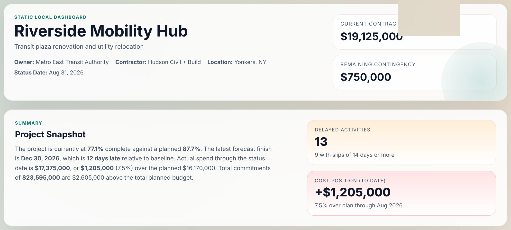
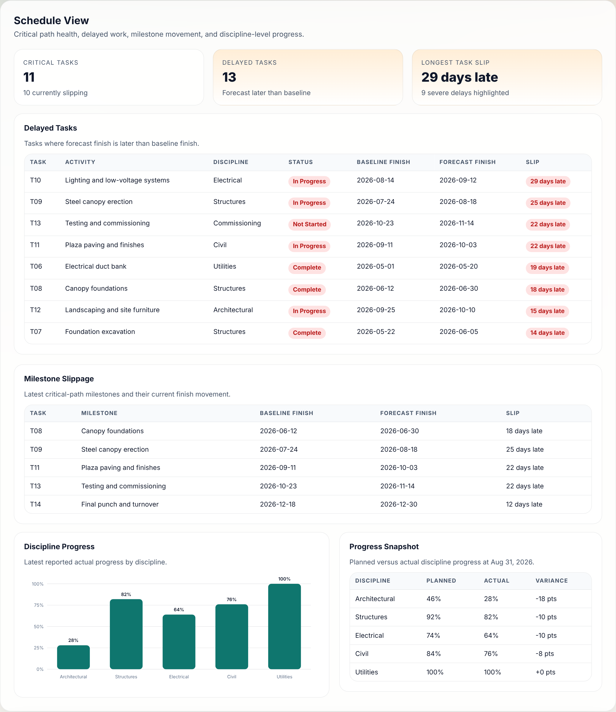
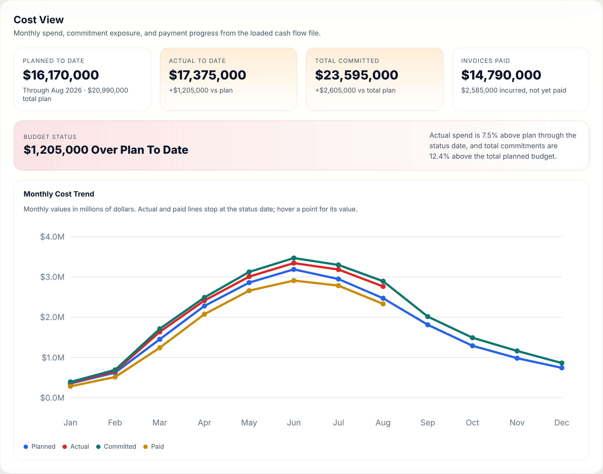
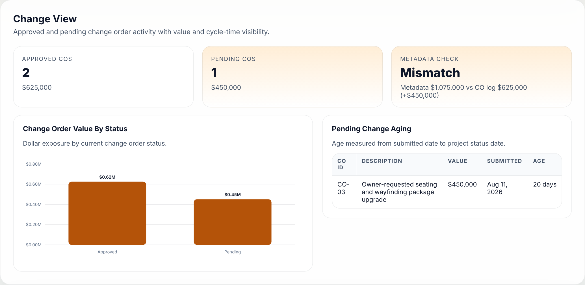
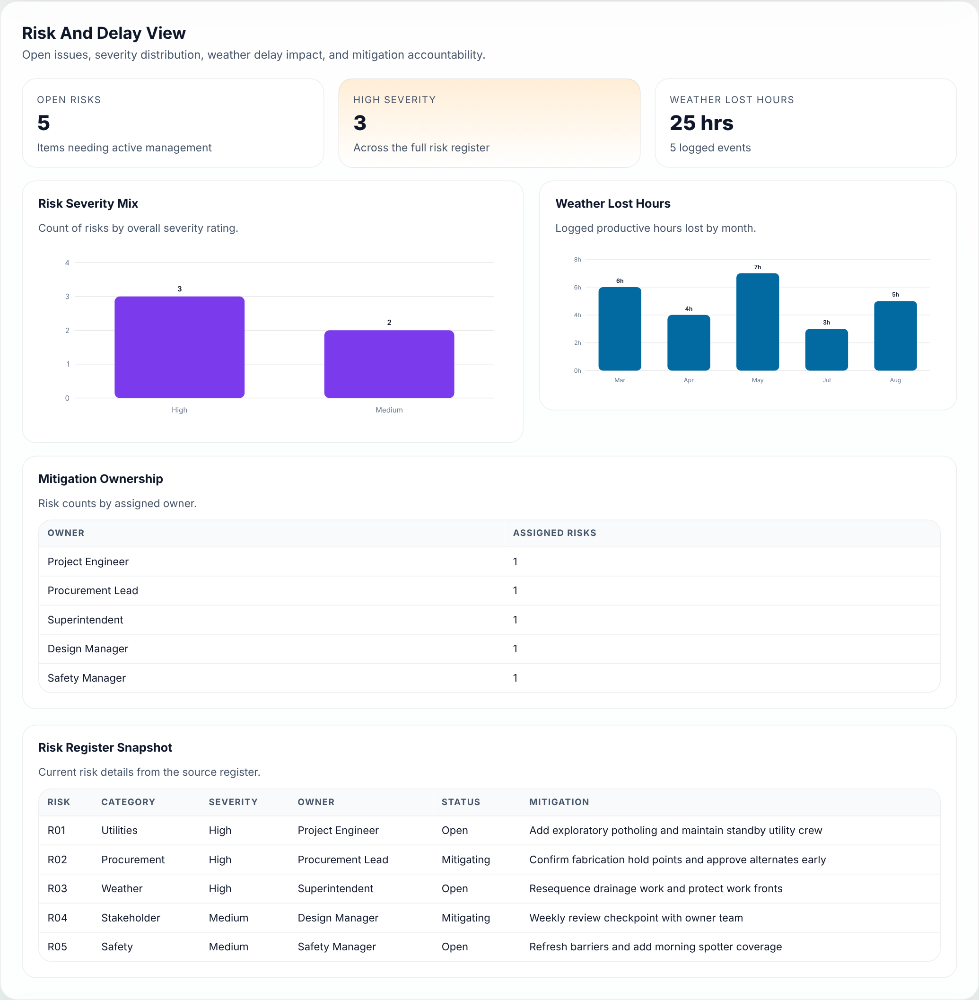
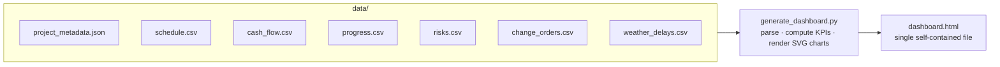

# Construction Project Controls Dashboard

**A zero-dependency Python tool that turns raw schedule, cost, change-order and risk files into a one-page project health dashboard for an owner or PM.**


-2E7D32)


<p align="center">
  
</p>

> **Live output:** [`dashboard.html`](dashboard.html). Download it and open it in any browser. It needs no server and no internet.
> The project shown, *Riverside Mobility Hub*, is a **fictional sample project** used to demonstrate the tool.

---

## The problem

On a live construction project, the information a PM needs every week sits in separate places: the schedule, the cost report, the change order log, the risk register, and the daily reports. Building a status report by hand is slow, and the numbers can easily disagree.

This tool reads seven plain data files exported from those systems and produces a **single, consistent snapshot** at the reporting status date. It answers the questions an owner asks first:

| Question | Where it's answered |
|---|---|
| Are we on schedule? Which activities are slipping and by how much? | **Schedule View**: critical tasks, delayed tasks, milestone slippage, discipline progress |
| Are we on budget? | **Cost View**: planned vs. actual to date, commitments vs. total budget, invoices paid |
| What's changing the contract? | **Change View**: approved vs. pending COs, pending CO aging, log vs. metadata reconciliation |
| What could hurt us next? | **Risk & Delay View**: severity mix, ownership, weather lost hours |

## What the sample project shows (status date Aug 31, 2026)

- **Schedule:** 77.1% complete vs. 87.7% planned. The forecast finish is **Dec 30, 2026, 12 days late**. 13 of 14 activities are slipping, including 10 of 11 critical-path activities, and the longest slip is 29 days (lighting and low-voltage systems).
- **Cost:** actual spend is **$17.38M against a $16.17M plan to date, $1.21M (7.5%) over**. Total commitments of $23.60M exceed the $20.99M total planned budget by $2.61M.
- **Changes:** 2 approved COs ($625K) and 1 pending ($450K, 20 days old). The metadata's approved-change total ($1.075M) **doesn't reconcile** with the CO log. The $450K gap equals the pending CO, which suggests it was counted before approval.
- **Risk:** 5 open risks, 3 of them high-severity (utilities, steel procurement, weather), plus 25 hours lost to weather.

<p align="center">
  
</p>
<p align="center">
  
</p>

<details>
<summary><b>Change and risk views</b></summary>
<p align="center">
  
  
</p>
</details>

## How it works



**Key calculations**

| Metric | Method |
|---|---|
| Percent complete / planned | Budget-weighted average of activity % complete vs. baseline % complete |
| Task slip | `forecast_finish − baseline_finish` in calendar days. A slip of 14 days or more is flagged severe |
| Project forecast finish | Latest forecast finish across all activities, compared with the contract baseline finish |
| Cost variance to date | `Σ actual − Σ planned` **for months up to and including the status month** |
| Commitment exposure | Total committed cost vs. total planned budget (all months) |
| Pending CO aging | `status_date − submitted_date` |
| Change reconciliation | Approved COs in the log vs. `approved_change_orders_usd` in the metadata |

The script uses only the Python standard library (`csv`, `json`, `datetime`, `html`). The charts are hand-built SVG, so the output has **no JavaScript, no CDN and no external assets**. You can email it, archive it with the monthly report, or open it offline on site.

## Run it

```bash
git clone https://github.com/app2171-netizen/construction-project-controls-dashboard.git
cd construction-project-controls-dashboard
python3 generate_dashboard.py      # writes dashboard.html
open dashboard.html                 # or double-click it
```

To use your own project, replace the files in `data/` while keeping the same columns. See the **[data dictionary](docs/data_dictionary.md)**.

## Review and fixes (v2)

The first version was built quickly through prompt-driven, AI-assisted development. A project-controls review of its output found several problems, now fixed. You can compare the two versions in the commit history.

| # | Issue in v1 | Impact | Fix |
|---|---|---|---|
| 1 | **Planned cost was summed for all 12 months, but actual cost only through August** | An over-budget project was reported as **"$3.6M (17.2%) under plan"**. The true position is **$1.2M (7.5%) over** | Planned, actual and paid amounts now stop at the status month. Commitments are compared against the total budget |
| 2 | The "Cost Position" card was colored green while saying cost was over plan | Mixed signal on the key metric | One `over_budget` flag now drives every cost color |
| 3 | Negative variances printed as `$-3,615,000` | Read as a typo | New `signed_currency()` helper prints `+$1,205,000` / `-$3,615,000` |
| 4 | The "Metadata Check" card only displayed a number | The $450K mismatch went unnoticed | The card now reconciles the CO log against the metadata and flags **Mismatch** |
| 5 | Actual and paid lines dropped to $0 after the status date | Looked like spending stopped | Lines now end at the status date |
| 6 | Value labels on every point of four overlapping lines | Unreadable chart | Labels removed and hover tooltips added |
| 7 | Rotated bar-chart labels ran off the SVG, and axis ticks repeated (`2, 2`) | Clipped or duplicated labels | Horizontal labels and "nice" axis maximums |
| 8 | Wide tables overflowed their panels | Columns were cut off | Wide tables span the full width, dates don't wrap, and grid items can shrink |

## Repository structure

```
├── generate_dashboard.py     # the generator (stdlib only)
├── dashboard.html            # generated output for the sample project
├── data/                     # 7 input files (sample project)
│   └── README.md             # notes on the sample data
└── docs/
    ├── data_dictionary.md    # every input field defined
    └── screenshots/
```

## Ideas for next steps

- **Earned value:** EV, PV, AC with CPI/SPI and EAC, using budget-weighted progress against the cash flow
- **S-curve:** cumulative planned vs. actual vs. committed spend
- **Critical path:** derive it from the `predecessor` links instead of relying on a manual `critical_flag`
- **Direct exports:** read P6 XER/XML or Excel cost reports directly
- **History:** keep one dashboard per status date so trends over time are visible

## License

[MIT](LICENSE)
